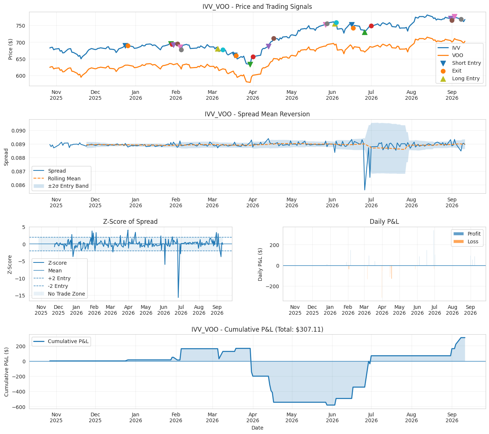
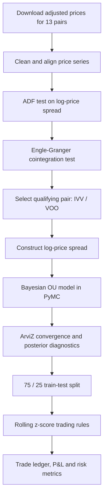
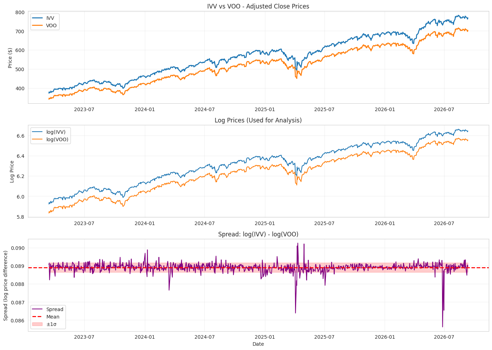
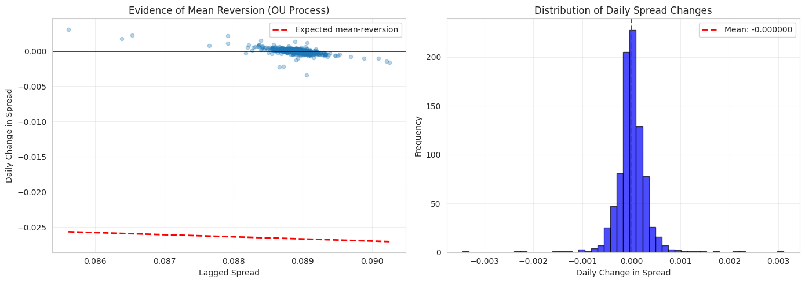
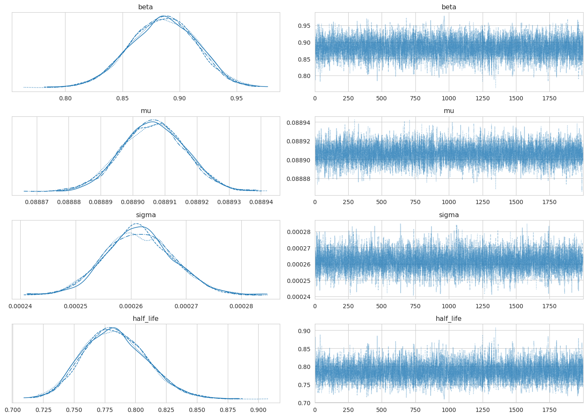
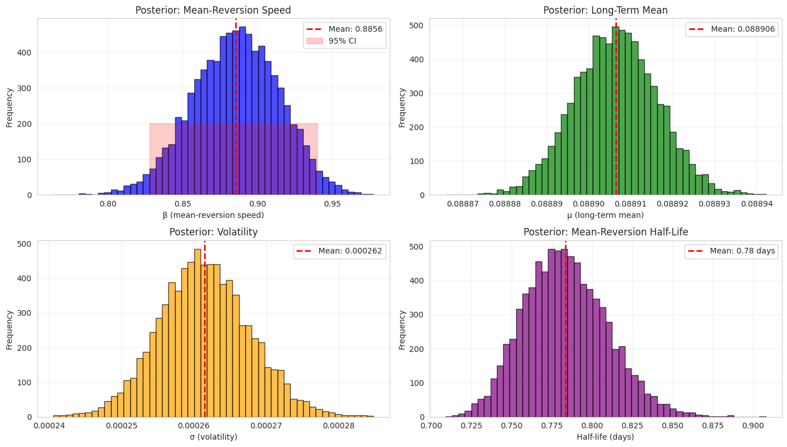
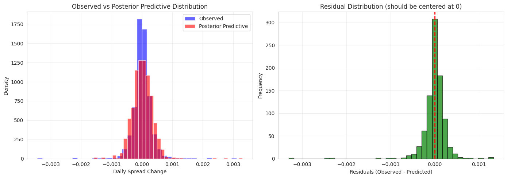
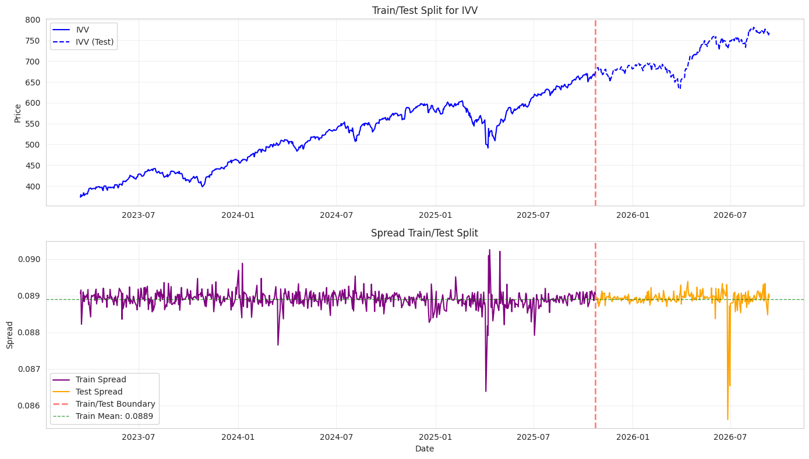
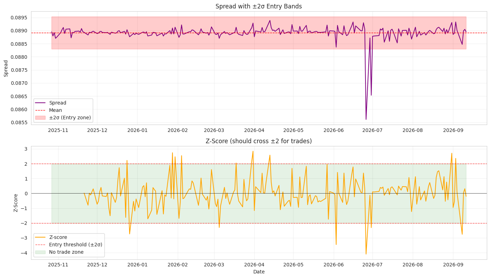
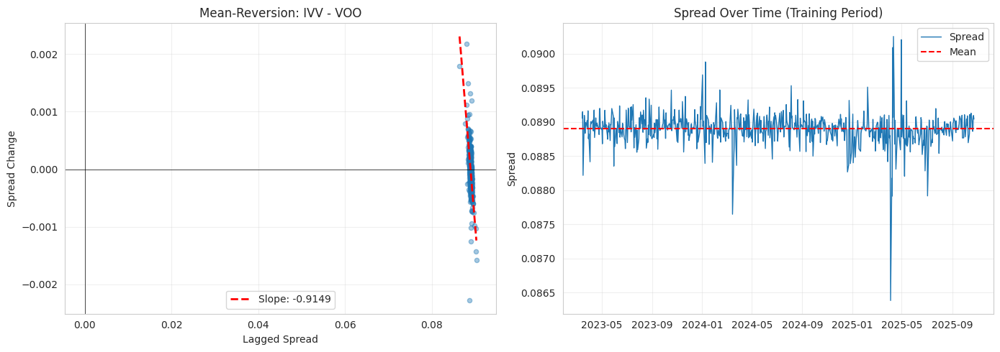

# Bayesian MCMC Calibration of a Mean-Reversion Pairs Trading Strategy

A research project combining statistical pair selection, Bayesian inference, and a rolling z-score pairs-trading backtest. The original executed Jupyter notebook and its figures are included; the Python package separates the workflow into reusable modules.



## Project overview

The experiment evaluates 13 equity and ETF pairs using approximately three and a half years of daily adjusted-price data. It screens candidate pairs with the Augmented Dickey–Fuller (ADF) test and the Engle–Granger cointegration test, selects a pair that passes both checks, models its log-price spread with an Ornstein–Uhlenbeck-style mean-reversion equation, and evaluates a threshold-based trading strategy on a held-out time segment.

**Selected pair in the archived notebook run: IVV–VOO.** The archived run uses observations from 15 March 2023 through 11 September 2026. The notebook's Yahoo Finance end-date argument was 12 September 2026 (exclusive).

## Workflow



## Main methods

### 1. Pair screening

For each candidate pair (P₁, P₂), the notebook constructs the log-price spread:

**Sₜ = log(P₁,ₜ) − log(P₂,ₜ)**

It tests the spread for stationarity with ADF and tests the two log-price series for cointegration with Engle–Granger. A pair is retained when both p-values are below 0.05.

### 2. Bayesian mean-reversion model

The spread dynamics are approximated by the discrete-time mean-reversion equation:

**ΔSₜ = β(μ − Sₜ₋₁) + εₜ, εₜ ~ N(0, σ²)**

The model uses the following priors:

- **Mean-reversion speed:** β ~ Beta(2, 5)
- **Long-run spread level:** μ ~ N(0, 1)
- **Innovation scale:** σ ~ HalfNormal(0.1)

The half-life is represented as:

**t½ = ln(2) / (β + 10⁻⁶)**

The archived notebook samples four NUTS chains with 1,000 tuning steps and 2,000 posterior draws per chain. ArviZ is used for posterior summaries, R-hat (R̂), effective sample size (ESS), trace plots, and posterior predictive checks.

### 3. Trading rules and backtest

The backtest calculates a rolling z-score using a 20-observation window and lagged rolling mean and standard deviation. It enters a long spread when z < −2, a short spread when z > 2, and exits when the z-score returns to zero. The original backtest uses a notional position size of USD 100,000 and closes any position still open at the end of the test sample.

## Archived experiment results

The numbers below are transcribed from the **saved notebook execution**, not generated by running the project again. Market data providers can revise historical prices, and a fresh run can produce different results.

| Item | Archived result |
|---|---:|
| Candidate pairs screened | 13 |
| Selected pair | IVV–VOO |
| Observations | 877 |
| Training / test observations | 657 / 220 |
| Posterior mean of mean-reversion speed (β) | 0.8856 |
| Posterior mean of long-run level (μ) | 0.088906 |
| Posterior mean of innovation scale (σ) | 0.000262 |
| Posterior mean half-life | 0.78 days |
| Number of test-period trades | 14 |
| Winning trades / win rate | 9 / 64.29% |
| Total P&L | USD 307.11 |
| Profit factor | 1.3754 |
| Annualised Sharpe ratio | 0.5413 |
| Maximum drawdown | USD -746.50 |

**Interpretation:** The archived strategy produced positive aggregate P&L and a profit factor above one, but its reported Sharpe ratio was below one. The result is a small historical simulation, not evidence of a robust or deployable trading edge.

## Visual results

### Pair price exploration — IVV and VOO



### OU-model data preparation



### MCMC convergence



### Posterior parameter distributions



### Posterior predictive check



### Train-test split



### Test-period spread and z-score diagnostics



### Mean-reversion validation



### Full backtest dashboard


All 13 pair-exploration plots and all other embedded notebook figures are retained in [`results/figures/`](results/figures/). The archived trade ledger and metrics are also available as [`results/archive_trades.csv`](results/archive_trades.csv) and [`results/archive_metrics.json`](results/archive_metrics.json). See [`docs/FIGURES.md`](docs/FIGURES.md) for the complete figure index.

## Repository structure

```text
bayesian-mcmc-pairs-trading/
├── README.md
├── requirements.txt
├── pyproject.toml
├── LICENSE
├── .gitignore
├── notebooks/
│   └── original_experiment.ipynb
├── src/pairs_trading/
│   ├── config.py          # Candidate pairs and experiment parameters
│   ├── data.py            # Yahoo Finance download and cleaning
│   ├── screening.py       # ADF and Engle–Granger tests
│   ├── bayesian_ou.py     # PyMC OU model and posterior inference
│   ├── backtest.py        # Rolling z-score backtest
│   ├── performance.py     # P&L, Sharpe, drawdown, profit factor
│   ├── plotting.py        # Reusable diagnostic and result plots
│   └── pipeline.py        # End-to-end orchestration
├── scripts/
│   └── run_analysis.py
├── results/
│   └── figures/           # Figures embedded in the executed notebook
├── docs/
│   └── FIGURES.md
└── tests/
    └── test_backtest.py
```

## Setup

Python 3.10 or later is recommended.

```bash
git clone https://github.com/YOUR_USERNAME/bayesian-mcmc-pairs-trading.git
cd bayesian-mcmc-pairs-trading

python -m venv .venv

# Windows PowerShell
.venv\Scripts\Activate.ps1

# macOS / Linux
source .venv/bin/activate

python -m pip install --upgrade pip
pip install -r requirements.txt
pip install -e .
```

## Run the analysis

```bash
python scripts/run_analysis.py
```

The default run uses the date range from the archived experiment. Override it as needed:

```bash
python scripts/run_analysis.py --start 2022-01-01 --end 2026-10-01 --draws 2000 --tune 1000 --chains 4
```

The end date is exclusive, following Yahoo Finance's API convention. Downloading data requires an internet connection. Generated tables, plots, and CSV files are written to `results/generated/` (ignored by Git by default).

To inspect the original analysis and its saved outputs, open `notebooks/original_experiment.ipynb` in Jupyter Notebook or JupyterLab.

## Important research limitations

This repository preserves the original notebook workflow for reproducibility. The archived experiment has limitations that should be addressed before treating the backtest as an out-of-sample performance estimate:

1. **Look-ahead in calibration:** The notebook estimates the OU parameters on the full selected spread and only then creates the 75/25 train-test split. Thus, the MCMC calibration sees observations from the nominal test interval.

2. **OU coefficient used as a leg multiplier:** The posterior mean-reversion parameter (β) is passed to the backtest as the second-leg share multiplier. It is not an independently estimated cointegration hedge ratio.

3. **Simplified execution assumptions:** Commissions, bid-ask spread, market impact, slippage, borrow fees, financing, dividend treatment in live trading, and short-sale constraints are not comprehensively modelled.

4. **Screening definition:** ADF is applied to the simple log-price difference, while the Engle–Granger test is applied to the pair. A production workflow should estimate and validate a hedge-ratio-based residual spread.

5. **Historical data changes:** Yahoo Finance data can be revised. Re-running the pipeline is not guaranteed to reproduce the saved output figures or metrics exactly.

These points are explicitly documented rather than hidden. A next research iteration should estimate hedge ratios using training data only, fit the OU model on the training interval, freeze all parameters before testing, and include transaction costs and robust walk-forward validation.

